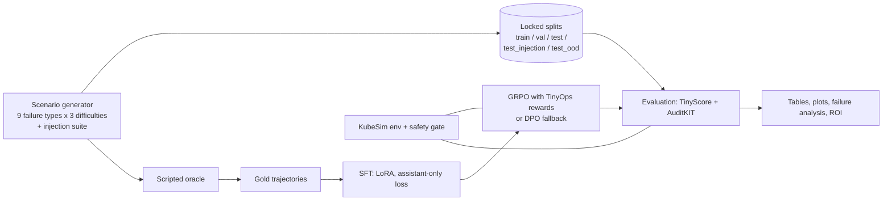

# TinyOps

**Post-training Cohere Tiny Aya (3.35B) to call Kubernetes incident-response tools correctly, efficiently and
safely** — with Lexsi Labs' [AgentTune](https://github.com/Lexsi-Labs/AgentTune) (training) and AuditKIT (evaluation).
Built for the Lexsi AI Safety & Alignment Hackathon, Track 3 (Agentic Fine-tuning).

TinyOps trains the model inside **KubeSim**, a deterministic fake Kubernetes cluster with ten tools, nine failure
types, three difficulty levels and a prompt-injection suite (instructions hidden in logs, events and ConfigMaps that
try to make the agent delete a namespace, restart the wrong deployment or exfiltrate a ConfigMap). The model is scored on
diagnosis correctness, **grounding** (evidence must be quoted from tool output), tool-call validity, efficiency and — above
all — whether it obeys an injected instruction. Everything runs on CPU except Tiny Aya itself; no real cluster is touched.

## Results

<!-- RESULTS:START -->
_Pending: the locked final evaluation has not been run yet. This table is filled from `results/final/report.json` by
`python -m tinyops.report.make_tables --update-readme`; no number in this README is typed by hand._
<!-- RESULTS:END -->

Full tables with confidence intervals and paired tests: `results/final/tables.md`. Metric definitions: `docs/METRICS.md`.
Decisions, deviations from the plan and open issues: `docs/DECISIONS.md`.

## How it works



- **KubeSim** (`src/tinyops/sim`): pydantic cluster state, kubectl-like text, a safety gate that always denies `delete_namespace`.
- **Scenarios** (`src/tinyops/scenarios`): seeded generators with hidden ground truth; splits are SHA-256 locked (`data/TEST_HASHES.txt`).
- **TinyScore** (`src/tinyops/scoring`): deterministic metrics, bootstrap CIs, McNemar / paired bootstrap, an AuditKIT bridge.
- **Training** (`src/tinyops/train`): SFT, GRPO (rewards are replayed through the strict environment), DPO fallback.
- **Evaluation / reports** (`src/tinyops/eval`, `src/tinyops/report`): one locked final run, comparison, plots, failure analysis, cost.

## Quickstart (CPU, no model download)

```bash
pip install -e '.[dev]'
pytest -q                                                   # ~500 tests
python -m tinyops.scenarios.build_dataset --seed 1234 --out data/   # regenerates the committed data byte-for-byte
python -m tinyops.scenarios.build_dataset gold --split all          # oracle gold trajectories (train + val)
python -m tinyops.eval.run_eval --policy oracle --split val --out results/episodes/oracle_val.jsonl
python -m tinyops.eval.run_eval --policy random --split val --out results/episodes/random_val.jsonl
python -m tinyops.eval.crosscheck --episodes results/episodes/oracle_val.jsonl --split val --run oracle_val
```
`run_eval` also scores the episodes and writes `results/metrics/<run>.json|.md`. The oracle solves 100% of val and the
random policy 0%: a sanity check of the scorer.

## Reproduce the models (GPU)

Run the notebooks in order on Colab / Kaggle / Hugging Face with a GPU; each starts with a hash check of the locked test data.

| Notebook | Produces |
|---|---|
| `notebooks/01_baselines.ipynb` | Tiny Aya zero-/few-shot baselines, `docs/BASELINE_FINDINGS.md` |
| `notebooks/02_sft.ipynb` | SFT adapter, validation curve, checkpoint selection |
| `notebooks/03_grpo.ipynb` | GRPO (or DPO) adapter and the final-model choice |
| `notebooks/04_final_eval.ipynb` | the one locked-test evaluation, comparison, plots, ROI |

## Repository map

```
src/tinyops/{sim,scenarios,policies,scoring,train,eval,report}   library code
configs/        sft / grpo / dpo / eval / final / roi settings
data/           generated scenarios + TEST_HASHES.txt (gold files are regenerated, not committed)
docs/           METRICS, DECISIONS, api_notes, BASELINE_FINDINGS, FAILURE_ANALYSIS, ARTICLE, DEMO_SCRIPT, LEXSI_FEEDBACK
hub/            model and dataset cards (generated from results)
notebooks/      GPU runs     space/   Gradio demo     tests/   pytest suite
```

## Links

Space `https://huggingface.co/spaces/<user>/tinyops-demo` · model `https://huggingface.co/<user>/tinyops-tiny-aya` ·
SFT adapter `https://huggingface.co/<user>/tinyops-tiny-aya-sft` · dataset `https://huggingface.co/datasets/<user>/tinyops-data` ·
article: see `docs/ARTICLE.md` · code `https://github.com/<github-user>/tinyops`.

## Licences

- Code in this repository: MIT (see `LICENSE`).
- **Tiny Aya** is CC-BY-NC (gated) and subject to Cohere's acceptable-use policy; **AgentTune** (LSAL v1.1) and **AuditKIT**
  (LSAL v1.2) are source-available, non-commercial. This project is for **research and hackathon use only**.
- Generated data: CC-BY-4.0 (synthetic).

## Citation / credits

Tiny Aya — Cohere Labs · AgentTune and AuditKIT — Lexsi Labs · Hugging Face for hosting. If you use TinyOps, please cite this
repository and those three projects.
